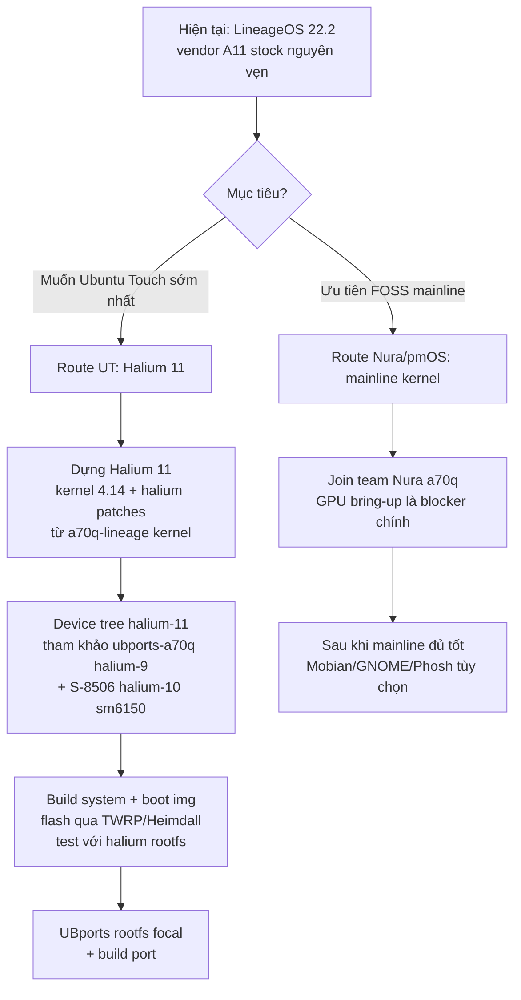

# Nghiên cứu: Chạy Linux di động trên Samsung Galaxy A70 (a70q)

Ngày: 2026-11-10. Trạng thái: **chỉ nghiên cứu, chưa flash gì cả.**

## 1. Thiết bị hiện tại (đọc trực tiếp qua ADB)

| Mục | Giá trị |
|---|---|
| Model | SM-A705F (`a70q`) |
| SoC | Qualcomm Snapdragon 675 (SM6150), GPU Adreno 612 |
| Bộ nhớ trong | UFS 2.1 (bootdevice `1d84000.ufshc`) |
| Kernel | 4.14.190-perf+ |
| ROM đang chạy | **LineageOS 22.2 (Android 15)** unofficial — `lineage_a70q-userdebug 15 BP1A.250505.005 eng.rtd125 test-keys` |
| Builder | rtd1250 (dev maintainer chính của a70q) |
| Root | Có sẵn `su` ở `/product/bin/su` (build userdebug, không qua Magisk) |
| Vendor partition | **Android 11 stock Samsung** — `samsung/a70qxx/a70q:11/RP1A.200720.012/A705FNXXU5DWB4:user/release-keys`, security patch vendor 2023-02-01 |
| Dynamic partitions / A-B | Không (layout Samsung cổ điển, A-only) |
| Recovery | Có partition `recovery` riêng (`/dev/block/sda22`), ngoài ra `boot`, `dtbo`, `vbmeta`, `system`, `vendor`, `product`, `userdata` đầy đủ |

**Bootloader/Knox:** máy đang chạy custom ROM ⇒ bootloader chắc chắn đã unlock (mọi prop `warranty_bit=0`, `verifiedbootstate=green` là do ROM spoof, không tin được). Knox eFuse gần như đã nổ từ trước. Cần xác nhận bằng mắt ở Download Mode trước khi flash bất cứ thứ gì.

## 2. Các lựa chọn OS Linux di động cho A70

| OS | Đường lối cho a70q | Trạng thái với A70 | Kết luận |
|---|---|---|---|
| **Ubuntu Touch (UBports)** | Halium 11 + vendor Android 11 (vendor đang nằm nguyên trên máy) | **Từng có port Alpha (2022)** chạy Halium 9: RIL, Wi-Fi, camera, audio, sensors, NFC, flashlight, sạc ngoài hoạt động; lỗi VoLTE, vân tay, GPS | ✅ Khả thi nhất, có byproduct port cũ làm nền |
| **postmarketOS / Nura** | Mainline kernel (Alpine-based). Nura = postmarketOS (đổi thương hiệu) | Port **testing**: màn hình, touch, USB networking, storage, flashlight, haptics chạy; **GPU, audio, Wi-Fi/BT, GPS, camera, pin báo lỗi hỏng**; chưa vào repositories chính thức | ⚠️ Dài hạn, đang vướng GPU (Adreno 612 timeout CP) |
| **PureOS** | Không có — bó hẹp cho Librem 5 (Debian + Phosh), không đường Halium cho máy Android | Không hỗ trợ A70 | ❌ Bỏ qua; tương đương Debian-mobile thực tế là Mobian (cùng phụ thuộc mainline kernel như pmOS) |
| **Mobian / Debian mobile** | Mainline kernel — cùng mức công việc với Nura, khác distro base | Không có port riêng | ⚠️ Chỉ đáng làm sau khi mainline kernel của a70q hoàn thiện hơn |

## 3. Tài nguyên cộng đồng đã xác nhận (còn sống trên GitHub)

**Android (nền tảng dựng Halium):**
- Org [`a70q-lineage`](https://github.com/orgs/a70q-lineage/repositories): `android_device_samsung_a70q`, `android_kernel_samsung_sm6150` (branch `upstream`, active 2026-05), `proprietary_vendor_samsung_a70q` + `sm6150-common`, device trees cho cả A70s/r1q (cùng/lien quan SoC)
- [`rtd1250/a70q_OTA`](https://github.com/rtd1250/a70q_OTA) — bản LineageOS build đang chạy trên máy (release 2025-11-02), cộng đồng Telegram @A70download còn sống
- [`rtd1250/pmos_a70q`](https://github.com/rtd1250/pmos_a70q) — cấu hình pmOS cơ bản
- [`rtd1250/a70q-fw`](https://github.com/rtd1250/a70q-fw) — firmware

**Ubuntu Touch (port cũ):**
- Org [`ubports-a70q`](https://github.com/orgs/ubports-a70q/repositories) — đủ 4 repo: `android_device_samsung_a70q` (branch `halium-9`), `android_kernel_samsung_a70q` (branch `lineage-16.0`, commit cuối 2025-01), `proprietary_vendor_samsung`, `rootfs-builder-debos`
- Thread XDA: [ROM][ALPHA][UBports] Ubuntu Touch for Galaxy A70 (OP: ataberkozen, 02/2022, Telegram @MacTavishAO)
- Lưu ý: port cũ là **Halium 9 / rootfs 16.04-era — đã chết theo dòng thời gian**, không flash lại được mà chỉ dùng làm tài liệu tham khảo những gì đã chạy được

**Tham chiếu Halium cùng SoC SM6150:**
- [`S-8506/halium_device_motorola_sm6150-common`](https://github.com/S-8506/halium_device_motorola_sm6150-common) + `halium_kernel_motorola_sm6150` — branch `halium-10` (cấu trúc tham khảo, khác base A10 vs A11 của mình)

**Mainline (Nura/pmOS):**
- Wiki: [Samsung Galaxy A70 (samsung-a70q)](https://wiki.nura.eco/wiki/Samsung_Galaxy_A70_(samsung-a70q)) — đóng góp chính: Jules (mainlining), Nergzd723 (touchscreen), Kdetechy.mp4 (EDK II). Có thể tham gia nhóm thay vì làm lại từ đầu

## 4. Lộ trình khuyến nghị

**Route khuyến nghị: Ubuntu Touch qua Halium 11** — lý do:
1. Vendor Android 11 stock còn nguyên trên máy = đúng base Halium 11, không cần kéo blobs khác
2. Port Halium 9 cũ chứng minh phần cứng chạy được qua libhybris (RIL/Wi-Fi/camera/audio/NFC)
3. Kernel + device tree LineageOS active, dev rtd1250 đang sống và build đều

**Rủi ro / blockers cần biết:**
- Halium 9→11 phải viết lại device tree (không nâng cấp trực tiếp được) — công việc chính là port tree, không phải viết driver mới
- VoLTE, vân tay, GPS port cũ chưa chạy — khả năng vẫn vậy ở Halium 11
- Adreno 612 trên libhybris: cần kiểm tra render path (port cũ bị nghi software-render lúc đầu)
- Flash A70: phải Heimdall/Download Mode hoặc TWRP; **quirk DTBO**: một số ROM Linux cần dtbo trống mới boot được — backup dtbo trước nếu động tới
- Knox: máy đã unlock từ trước (custom ROM), nhưng xác nhận lại ở Download Mode trước khi flash

## 5. Việc trước khi làm bất cứ gì (read-only / backup only)

1. Chụp lại màn hình Download Mode (xác nhận OEM Lock state, Knox)
2. Backup qua TWRP hoặc `adb pull` (root có sẵn): `dtbo`, `boot`, `vbmeta`, `efs`, `param` — lưu ra máy tính
3. Xác nhận biến thể máy (A705F vs FN — khác chip NFC PN80T/PN553, ảnh hưởng routing NFC khi port)

## Nguồn

- Device probe ADB trực tiếp (2026-11-10)
- https://wiki.nura.eco/wiki/Samsung_Galaxy_A70_(samsung-a70q)
- https://xdaforums.com/t/rom-alpha-ubports-ubuntu-touch-for-galaxy-a70.4397397/
- https://docs.ubports.com/en/latest/porting/ + https://docs.halium.org/
- GitHub orgs: a70q-lineage, ubports-a70q, rtd1250, S-8506 (halium-10 sm6150)

---

# Phụ lục: Ma trận tính năng — "mọi tính năng phải work" (2026-11-10)

Mục tiêu: máy chạy Linux di động với **mọi tính năng hoạt động như máy thường**.

## Bằng chứng từ device tree Halium-9 cũ (org ubports-a70q, nhánh halium-9)

Tree cũ chứa đầy đủ glue cho mọi khối phần cứng — tất cả đã được wrap/sửa cho Halium 9:

- `fingerprint/` + `fod/`: HAL `vendor.samsung.hardware.biometrics.fingerprint@2.1` (custom BiometricsFingerprint.cpp) + `vendor.lineage.biometrics.fingerprint.inscreen@1.0` (FingerprintInscreen) → **A70 là vân tay dưới màn hình (FOD)**, HAL Android đã được viết lại hoàn chỉnh cho tree port
- `hidl/interfaces/radio/1.2/`: IRadio HIDL custom (bỏ qua các check Samsung) → RIL đã được patch cho Samsung
- `audio/`: đủ bộ config HAL audio Qualcomm (mixer_paths, audio_platform_info, audio_effects, sound_trigger) → audio HAL chạy qua vendor blobs
- `configs/gps/`: Qualcomm izat (gps.conf, izat.conf, flp, sap) → GPS HAL config đầy đủ
- `configs/nfc/`: libnfc-nxp + RF config → NFC NXP
- `light/lights.c`, `livedisplay/`, `doze/`, `keylayout/sec_touchscreen.kl`: lights, display modes, ambient, touch key layout

Nghĩa là: phần "viết driver glue cho Android container" của port Halium **đã từng được làm xong một lần cho máy này**. Công việc Halium 11 = nâng port đó lên base A11 (tree LineageOS hiện tại của a70q-lineage đã là base A11 vendor chính là thứ mình cần).

## Ma trận tính năng

| # | Tính năng | HW liên quan | Route UT/Halium 11 | Route mainline (Nura/pmOS) |
|---|---|---|---|---|
| 1 | Màn hình + touch + độ sáng | S6E3FC2 AMOLED, IST4050 | ✅ Chạy (port cũ + LineageOS) | ✅ Chạy (DRM panel WIP upstream) |
| 2 | GPU tăng tốc | Adreno 612 | ⚠️ Qua hwcomposer/gralloc bridge — port cũ bị nghi software-render lúc đầu, **cần confirm sau khi boot** | 🔶 Patch a6xx a612 đã tới v6 (01/2026), enable trong kernel 6.19-rc3 cho QCS615 — GPU mainline sắp chạy, cần DTS |
| 3 | Wi-Fi | WCN3980 (driver wcn3990) | ✅ Chạy ở port cũ | 🔶 ath10k SNOC hỗ trợ wcn3990-family upstream; a70q chưa có DTS/fw → hiện Broken |
| 4 | Bluetooth | WCN3980 | ❓ Port cũ không đề cập — cần test | ❓ Tương tự WiFi (hci_qca), chưa chạy |
| 5 | Âm thanh (loa/mic/tai nghe) | WCD9370 + WSA8815 | ✅ Chạy ở port cũ (full HAL config) | 🔶 Codec drivers đã upstream (wcd937x merged 2024, wsa881x) — thiếu machine driver + DTS sm6150 |
| 6 | RIL: gọi/SMS/data | SDR660 modem | ✅ Chạy ở port cũ (IRadio custom) | ❌ Modem chưa lên mainline cho sm6150 |
| 7 | VoLTE | IMS stack Qualcomm | ⚠️ UT hỗ trợ VoLTE từ OTA-8 nhưng chứng minh trên port nền Android 12 (Volla X23/22); A70 chỉ có vendor A11 → **chưa chứng minh, phải test** (IMS service A11 tồn tại) | ❌ VoLTE mainline không thực tế |
| 8 | GPS | Qualcomm izat + SDR660 | ⚠️ Config đầy đủ trong tree cũ nhưng port cũ để "untested" → geoclue-provider-hybris chuẩn, khả năng chạy sau một vòng debug | ❌ Phụ thuộc modem mainline |
| 9 | Camera | S5KGD1/S5K4HA/GC5035 + S2MPB03 | ⚠️ Chạy ở port cũ: 2/3 lens, max 12MP (giới hạn blobs Samsung) | ❌ camss sm6150 chưa upstream — khó nhất của route mainline |
| 10 | NFC | NXP PN80T (FN) / PN553 | ✅ Chạy ở port cũ (config NXP đầy đủ); UT có nfcd | ❌ |
| 11 | Cảm biến (accel/mag/ALS/proximity) | LSM6DSL, AK09918C, TCS3701, STK3031 | ✅ Chạy ở port cũ | 🔶 2/4 supported upstream nhưng cần SSC (sensors DSP) bring-up |
| 12 | Vân tay (dưới màn hình) | Samsung FOD HAL (vendor) | ⚠️ **Sửa nhận định cũ**: UT noble CÓ hỗ trợ vân tay (biometryd/libfprint — chứng minh: curtana, vân tay cạnh, Working). Nhưng **in-display quang học chưa có precedent chạy** (spacewar/Nothing Phone 1 in-display = Not Working). A70 FOD Samsung: phải tự bridge biometryd ↔ HAL Samsung 2.1 có sẵn trong tree cũ — chưa chắc, làm sau khi các mục chính chạy | ❌ FOD Samsung không có driver Linux |
| 13 | Pin + sạc + báo % | SMB1390, fuel gauge | ✅ Chạy ở port cũ | ❌ SMB1390 chưa có driver mainline; báo pin Broken |
| 14 | Sạc khi tắt máy (offline charging) | Bootloader Samsung | ✅ Chạy ở port cũ (độc lập OS) | ✅ (bootloader-level) |
| 15 | Flashlight, haptics, Hall | LED, motor, AH1897T | ✅ Chạy cả 2 route | ✅ Chạy |
| 16 | MMS | RIL | ⚠️ Infra MMS của UT có sẵn; cần config carrier | ❌ |
| 17 | Waydroid (app Android) | LXC + binder | ⚠️ OP port cũ chưa chạy được; các port Halium 11 mới (Nothing Phone 1) đã kèm Waydroid → khả thi hơn trên Halium 11 | ⚠️ Cần binder/mainline + GPU (mesa freedreno) |
| 18 | Chế độ máy tính (desktop out) | USB-C chỉ USB 2.0, **không DP alt-mode** | ❌ Không có video-out qua cáp; chỉ scrcpy/screencast qua mạng. libertine chạy app desktop trên máy | ✅ nếu mainline đủ: Debian desktop thật trên chính màn hình máy |

## Kết luận cho mục tiêu "mọi tính năng phải work"

**Không route nào cho 100% ngay hôm nay.** Thực tế nhất:

1. **Route UT/Halium 11 cho ~14–15/18 mục chạy được** (toàn bộ những gì port cũ từng chạy + ưu thế UT hiện đại hơn 2022). Ba mục còn lại:
   - **VoLTE**: cơ hội thật — test sớm sau khi boot; nếu IMS A11 không chạy thì đành dùng 3G/VoNR fallback hoặc chờ UBports mở rộng
   - **Fingerprint**: sửa nhận định — UT noble có khung vân tay (biometryd), nhưng A70 là in-display FOD Samsung (loại chưa có precedent chạy trên UT: spacewar in-display cũng Not Working). Làm cuối cùng sau các mục chính; PIN/passcode là fallback
   - **Desktop-out qua cáp**: giới hạn phần cứng (USB-C 2.0 không DP alt-mode) — không route nào vượt được
2. **Route mainline (Nura)**: hướng đi đẹp nhất về FOSS dài hạn, và đúng lúc — GPU a612 đang vào mainline (6.19), codecs audio đã upstream, touch đang chờ merge. Nhưng camera + modem + charging IC là 3 tầng việc lớn còn thiếu → thực tế **1–3 năm cộng đồng**, không phải 1 người làm hết
3. **Chiến lược hợp lý**: làm Halium 11 trước (máy dùng được sớm), giữ kernel/patch đóng góp ngược cho Nura/pmOS song song (cùng một kernel tree có thể phục vụ cả hai)

## Việc tiếp theo (khi quyết định triển khai)

1. Backup: `dtbo`, `boot`, `vbmeta`, `efs`, `param` qua root shell (su có sẵn) → lưu máy tính
2. Chụp màn hình Download Mode (xác nhận Knox/OEM lock state)
3. Clone + đọc kỹ: `ubports-a70q/android_device_samsung_a70q` (halium-9) làm bản đồ, `a70q-lineage/*` (base A11) làm nền build Halium 11
4. Liên hệ cộng đồng (đã xác minh 2026-11-10): ~~OP cũ~~ — `MacTavishAO` (GitHub của ataberkozen) **0 hoạt động công khai**, xem như unreachable. Đầu mối thay thế: **rtd1250** (Telegram @A70download, GitHub active 10/2026 — maintainer LineageOS đang chạy trên máy), team Nura/pmOS (wiki talk + Matrix #postmarketos), UBports porting forum/Telegram (hỏi quy trình halium-11 + VoLTE trên base A11)
5. Nền build Halium 11: fork từ **nhánh `lineage-18.1` của rtd1250** (Android 11 base, đã patch quirk Samsung) — gần đích hơn nhiều so với halium-9 cũ; halium patches tham khảo docs.halium.org. Không ai có nhánh halium cho a70q trước đó → mình là người đầu
6. Thiết lập build env Halium 11 (docs.halium.org) + UBports build (docs.ubports.com/porting) — cần Linux x86_64 (không build trên macOS ARM)

